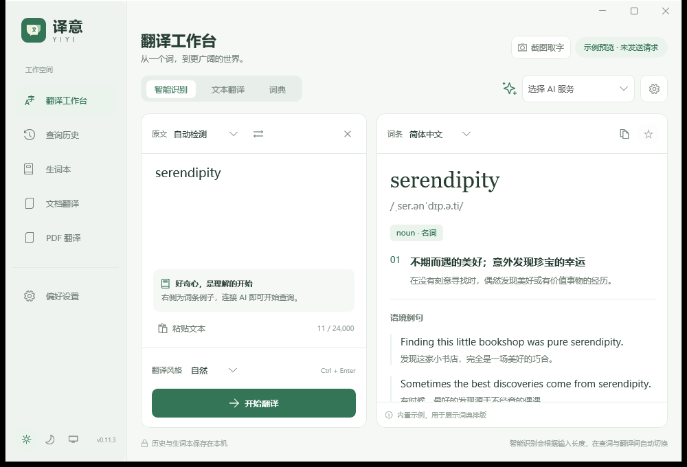

# 译意 Yiyi

使用 **C++/WinRT + WinUI 3** 开发的 Windows 桌面 AI 翻译词典。当前版本为 **0.11.3**。



## 下载与运行

解压 `dist/Yiyi-0.11.3-winui-windows-x64.zip`，运行 `Yiyi-WinUI/Yiyi.WinUI.exe`。x64 ZIP 约 68 MiB，解压约 105 MiB，包含本地 OCR 模型、PDFium、qpdf 及两套 PDF 字体。启动需要共享的 Windows App Runtime 2.4 x64。 [Windows App Runtime 下载](https://learn.microsoft.com/windows/apps/windows-app-sdk/downloads/)

首次启动点击「偏好设置 → 添加 AI 服务」。支持 Ollama、LM Studio、OpenAI Chat Completions、OpenAI Responses、Anthropic 和 Gemini。本地服务需事先启动，云端服务使用自己的 API Key。

默认用户数据位于 `%LOCALAPPDATA%\Yiyi\Yiyi`。设置写入 `settings.json`，历史和收藏写入 `history.sqlite`，文档任务存入 `office-tasks/` 和 `pdf-tasks/`。首次启动可读取原有 `settings.ini`，API Key 由当前 Windows 用户的 DPAPI 保护。更新前可从托盘退出正在运行的实例。

## 功能

- 查词、文本翻译及智能识别，支持简明词条和流式完整词条、多服务配置、可选思考等级，以及可搜索的历史和生词本。
- Windows 托盘、可配置的全局快捷键与划词浮标。截图支持本地 RapidOCR 和 AI 识图，校对后可复制、填入工作台或翻译。
- TXT 分段翻译可停止、续译及导出已完成部分。DOCX / PPTX 支持原格式导出、段落校对、单段重译和进度恢复。旧版 DOC / PPT 可先转换为 DOCX / PPTX。
- PDF 支持多栏、表格、扫描区域识别、原文与译文同步预览、暂停续接和结构校正。导出保留图片、链接和批注，嵌入可搜索的译文。无法安全替换的区域保留原文并列入检查清单。

文档和界面预览见 [使用说明](docs/使用说明.md)、[Word / PPT 翻译](docs/Office翻译-0.11.0.md)、[PDF 版式与导出](docs/PDF版式与导出.md)、[深色工作台](docs/screenshots/translate-dark.png)和[验证记录](docs/验证记录.md)。

## 构建与测试

开发环境需要 Visual Studio 的「使用 C++ 的桌面开发」工作负载、Windows SDK 10.0.26100.0、CMake 3.24 或更新版本，以及 Python 3。Visual Studio 2026 对应的生成器要求 CMake 4.2 或更新版本。构建脚本会准备工作进程所需的 OCR 和 PDF 依赖。可用 `-PythonPath` 指定用于准备 PDF 字体的解释器。

```powershell
powershell -NoProfile -ExecutionPolicy Bypass -File scripts/build.ps1 -SmokeTest -Package
```

Release 程序位于 `build/winui/Release/Yiyi.WinUI.exe`，可用以下参数在独立配置中启动：

```powershell
build/winui/Release/Yiyi.WinUI.exe --data-dir artifacts/manual-test --no-desktop
build/winui/Release/Yiyi.WinUI.exe --data-dir artifacts/pdf-test --no-desktop --pdf "C:\path\sample.pdf"
```

`--no-desktop` 关闭托盘、快捷键和划词监测。TXT、DOCX 和 PPTX 可用 `--document` 打开。使用 `-SmokeTest` 会运行启动检查。

准备依赖后运行回归测试。使用 Visual Studio 2022 时，将生成器改为 `Visual Studio 17 2022`。

```powershell
cmake -S winui/tests -B build/winui-tests -G "Visual Studio 18 2026" -A x64
cmake --build build/winui-tests --config Release
ctest --test-dir build/winui-tests -C Release --output-on-failure
cmake -S winui/pdf -B build/winui-pdf -G "Visual Studio 18 2026" -A x64
cmake --build build/winui-pdf --config Release
ctest --test-dir build/winui-pdf -C Release --output-on-failure
```

测试使用临时数据目录和本机模拟服务。Windows 托盘、快捷键及划词的交互验证需要可操作的桌面。

## 工程结构

| 路径 | 内容 |
| --- | --- |
| `winui/` | WinUI 界面、AI 请求、文档任务、SQLite 存储及 Windows 桌面集成 |
| `winui/pdf/`、`winui/ocr/` | PDF 和 OCR 独立工作进程 |
| `winui/tests/`、`tests/fixtures/` | 原生回归测试、文档和词典样例 |
| `assets/` | 应用图标及 Windows 版本资源 |
| `scripts/`、`tools/` | 构建、打包、依赖准备、字体处理及样例生成 |

PDFium 在独立工作进程中处理原页。DirectWrite 负责译文排版，qpdf 分批合成导出文件。PDFium、qpdf、Noto 字体和构建时的 FontTools 版本与哈希由 `scripts/pdf-dependencies.json` 固定。OCR 桥接库使用 RapidOCR 和 ONNX Runtime。 [第三方组件及许可](THIRD_PARTY_NOTICES.md)

## 版本记录

**0.11.3 词典结果容错。** 修复完整词条因备注或例句中的格式错误而退回原始 JSON 的问题：保留已完整解析的释义，不猜测未闭合的字符串。完整模式可接受简短文本，简明模式也能从结构化回答提取词性和译义；缺少有效释义或语言检查失败时不入库。缩短查词提示，扩展内容改为可选，每次仍只请求一次模型。

**0.11.2 完成任务重新翻译。** 修复已处理全部段落后主按钮显示灰色「继续翻译」的问题，改为可点击的「重新翻译」。取消保留旧译文及草稿；确认后按界面显示的语言、风格和服务从第一段重译。

**0.11.1 修复 Office 翻译设置。** 恢复任务后显示实际使用的模型服务、源语言、目标语言和风格；修改设置先确认重译，确认后按新设置开始，避免把英语选择显示在中文任务上。

**0.11.0 Word / PPT 翻译。** 「文档翻译」统一 TXT、Word、PPT 入口。直接翻译 OOXML 文字，保留表格、媒体、样式和对象关系，另存可编辑文件。支持页眉页脚、脚注尾注、备注、SmartArt 文字和图表富文本标题；图片可手动取字，关联图表数据和复杂自动内容保留并提示。详见 [Office 翻译说明](docs/Office翻译-0.11.0.md)。

**0.10.5 文件拖入。** 主窗口接收单个 TXT / PDF，显示拖放提示并按类型切换页面；打开后手动翻译。沿用 TXT 编码设置，保护未导出的译文和 PDF 缓存，处理期间与弹窗中避免意外替换。

**0.10.4 PDF 导出修复。** 导出可用译文，未通过排版或内容校验的区域保留原文，成功后显示数量并附 `.issues.txt` 清单。修复目录点线、密集索引、页码误判和系统字体发现；通过页面工作副本减少长书导出卡顿，合并跨段指令避免文字与图形偏移。不能安全重写的纹理页保留原页。

**0.10.3 PDF 异常恢复。** 内容校验失败最多自动重试 2 次；普通翻译中持续失败的段落记入待校对并继续后文，连续 3 段失败则暂停。失败返回可查看和复制，重开后只补未完成段落；当前页重译仍全部成功才替换。

**0.10.2 技术书籍翻译。** 修复文本提取、段落完整性、数学上下标、升级续译和页面右侧裁切，补充符号字体回退、异常响应检查和整书排版预检查；短标题与片段可参考上下文。

**0.10.1 模型等待与超时。** 普通生成请求的无数据等待由 90 秒延长至 10 分钟；PDF 可选 5 / 10 / 20 / 30 / 60 分钟，暂停后调整并继续。保留所选模型与思考等级，显示等待响应、等待正文或接收正文及请求用时。协议明确完成后及时结束请求，区分客户端无响应与 HTTP 408 / 504 / 524 服务端超时。

**0.10.0 PDF 界面与流程。** 翻译设置集中管理模型，更多菜单保留高级操作；页码直接输入跳转。扫描与文字页共用翻译/暂停/继续入口，任务范围、模型及进度保存到 SQLite。未处理与待校对按页展开，点击定位到段落。当前页重译整页成功才替换，清空全书译文另行确认。

**0.9.0 PDF 大文档。** 增加元数据预读、分批解析、逐页翻译和 SQLite 保存，兼容旧 JSON 任务。解析支持暂停、继续和显示进度。导出使用磁盘暂存，失败或取消时保留原文件与既有目标。 [PDF 版式与导出](docs/PDF版式与导出.md)

**0.8.1 PDF 整书验证修复。** 改进嵌套文字与颜色保留、流程图标签、代码注释及等宽排版、字母索引和图中英文清理。使用指定的 116 页 GLSL 技术书验证。

**0.8.0 PDF 复杂版式。** 增加多栏阅读顺序、表格单元格与数字校验、合并单元格/多级/跨页表头、无边框推断、结构校正和缓存恢复；图片背景支持纯色/渐变清理、可选 CPU 局部修复、底色框及保留原图对照。局部失败保留该区域，其他区域继续预览；纹理修复需要预览确认，不能保证照片无痕恢复。

**0.7.0 PDF 原版式翻译。** 扫描页不再新增 A4 译文页，改为在原尺寸页面的文字区域排版。普通 PDF 改善混合粗体、斜体与中英文字体选择；扫描页保留行级擦除区域，避免清空整段导致图形丢失。旧缓存保留文字草稿，需要重新识别坐标才能导出原版式译文。

**0.6.0 新增 PDF 扫描件。** 识图与翻译模型分别选择，识别原文与译文分别保存。支持当前页 / 指定范围识别、高清和局部框选，取消或失败保留旧内容。修改原文后提醒更新译文；重新翻译保留已校对原文。扫描原页后附对应译文，自动续页；混合 PDF 逐页处理。

**0.5.0 新增 PDF 翻译。** 面向有文字层的横排单栏文档，按段落翻译并在原页面位置重新排版；图片、矢量线条和未译内容保留。支持整篇 / 当前页、同步对照、缩放、点击段落校对、失败重试和本机持久化进度。导出嵌入中文字体的可搜索 PDF；放不下的译文标红并阻止导出，需修改后重试。扫描件及检测到的复杂版式保留原页，不做 OCR 翻译。首版目标语言为简体中文、繁体中文和英语。

**0.4.2 统一截图取字流程。** 本地 OCR 和 AI 识图都先返回可编辑的原文，统一提供「复制原文」「放入原文」「翻译文字」。同图切换分别保留两种方式的编辑内容，重新识别失败或取消保留原有修改。识图模型独立选择；翻译使用工作台当前模型，仅发送校对后的文字。

**0.4.1 移除 Windows OCR。** 删除界面入口、语言选择、系统 OCR 脚本、资源及调用代码。本地识别统一使用 RapidOCR，保留同图重新识别和 AI 识图翻译。

**0.4.0 升级截图识别。** 采用随包携带的 RapidOCR / PP-OCRv5 mobile CPU 模型，增加小字、深色背景预处理。另提供 AI 识图并翻译，同图切换模式、独立选择服务、点击才发送图片，支持五种协议。服务配置新增真实「测试识图」。

**0.3.0 新增截图 OCR 和 TXT 文档翻译。** 左侧「文档翻译」可导入 UTF-8、UTF-16、GB18030 / GBK TXT，按最多约 1,000 字符分段顺序翻译，支持进度预览、停止、继续与 UTF-8 导出。续译保留已完成段落，沿用任务开始时的服务、模型、思考等级和语言。

**0.2.1 修复图标缩放问题**：恢复图标的矢量绘制，修复 0.2.0 小图标的锯齿、发虚及线条粗细不一致，同时保留软件渲染时的滚动裁剪。

**0.2.0 新增系统托盘、全局快捷键和划词浮标。** 默认关闭窗口后留在托盘；`Ctrl+Alt+Y` 打开工作台，`Ctrl+Alt+D` 查询其他应用中选中的文字。拖动划选或双击选词后显示浮标，点击才向当前 AI 服务发送查询。可在「偏好设置 → 桌面与划词」调整开关和快捷键，在托盘菜单暂停划词或退出。部分应用不提供可读取的选择，此时可用取词快捷键或复制粘贴；0.2.0 当时不含 OCR。

0.1.1 新增 **OpenAI Responses** 协议。遇到 `/v1/chat/completions endpoint not supported` 时，编辑已有服务，将接口协议改为「OpenAI Responses」，基础地址仍可填写 `http://主机:端口/v1`，模型和 API Key 保持原配置。原来的「OpenAI 兼容」现在明确标为「OpenAI Chat Completions」。

0.1.2 使用与界面融合的无边框窗口，右上角保留最小化、最大化 / 还原和关闭按钮。按住左侧栏空白或品牌区域即可拖动，双击可最大化 / 还原，边缘和四角可调整尺寸。统一了各页面和弹窗的滚动行为，到顶到底停止回弹，反向滚动立即生效。

0.1.3 修复窗口按钮在鼠标点击后的残留焦点边框，主题按钮增加明确的悬浮和按下反馈。悬浮提示统一为适配浅色 / 深色的圆角样式，在点击、移开鼠标或窗口失活时收起；键盘导航仍保留焦点提示。

0.1.4 修复鼠标移入、移出主题按钮时的底色闪烁：悬浮层只改变透明度，避免颜色动画经过透明黑色。默认窗口缩为 **1000 × 680**，最小支持 **900 × 600**；侧栏、页边距、卡片和服务弹窗同步收紧，小窗口优先保留输入空间。

0.1.5 新增每个 AI 服务独立保存的 **思考等级（可选）**，适用于 OpenAI Responses、Chat Completions 及兼容接口。默认「跟随服务」完全省略思考参数，便于使用不支持此参数的本地模型；也可显式选择 `none`、`low`、`medium`、`high`、`xhigh`、`max`。设置同时用于连接测试、查词和翻译；可用等级由实际模型和服务决定，拒绝时提示调整设置，不会自动改级重试。

0.1.6 默认使用 **简短释义**，面向约 1B 的本地模型：只请求少量纯文本译义，由程序生成词条排版、历史和收藏数据。无需模型生成 JSON、音标、例句或搭配。可在 AI 服务配置的「词典内容」中切回「完整词条」，该设置按服务独立保存。旧配置也默认简短释义。全部内容仍由用户选定的 AI 服务生成，不使用离线词库或自动切换云端；中文查词若返回纯外文，会提示重试，不作为成功结果保存。

0.1.7 默认模式更新为 **简明词条**：只请求常用词性和简短译义，以 `v.`、`n.`、`adj.`、`adv.` 等缩写配合释义显示。仍是一次简短请求，不生成音标和例句。右侧不再重复左侧原词，复制结果也只包含词性与译义；打开 0.1.6 的简短释义历史时同样不重复原词。无法识别的词性留空，不由程序猜测补齐。

0.1.8 修复简明查词的翻译方向：明确要求将输入翻译成所选语言，优先一个常用译词及词性，减少扩展释义导致的重复和偏题。英文目标下夹带中文等其他文字、中文目标下缺少中文译义或没有有效词条时，不保存为成功结果。去除精确的「原词：」前缀与完全重复的译义；模型照抄整串词性选项时留空。补充中译英的协议、界面和真实 Qwen3.5-2B 验证；语言文字检查不能判断语义或词性是否正确。

0.1.9 完整词条改为分段显示：收到完整的释义条目后先展示，例句、搭配等随后补齐；生成中标明状态及等待时间，完成后显示首段响应与请求用时。预览不开放复制、收藏或历史保存；取消和中断会清除预览。完整词条保留原有内容类别，要求解释和例句简短。思考等级仍使用服务配置中的选择，每次查询只发送一次请求。分段显示改善首屏等待，不会缩短服务自身的推理或排队时间。

0.1.10 修复响应处理问题。支持含 `error: null` 的正常响应，响应长度检查覆盖最后一段。Gemini 异常结束后的部分输出不再保存为成功结果。
